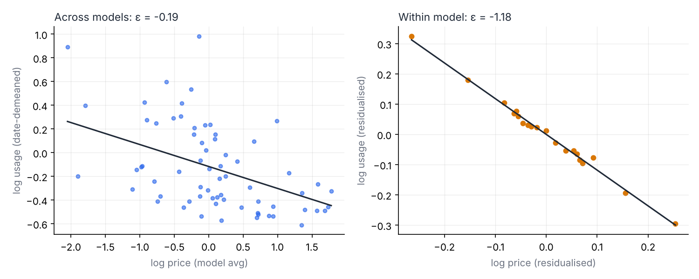
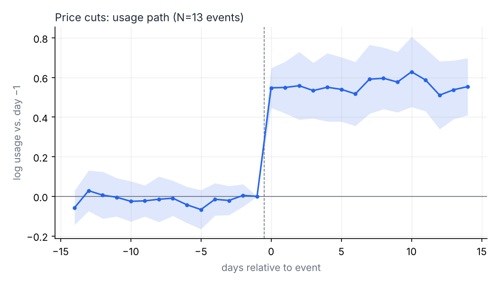

# How price-sensitive is LLM API demand?

**Price elasticity and free-tier effects on OpenRouter, Jan 2025 – present**

> **Status: data collection running.** Results below will be filled in from real data
> (winter 2026–27). Until then, every number in this README comes from the
> synthetic validation run (`make demo`) and is labelled as such.

## Question

1. **Average elasticity.** How much does LLM API token demand respond to price?
2. **Price-change events.** When the *same* model gets cheaper, how much does its usage rise?
3. **Free variants.** When a model's `:free` variant appears or disappears, does it
   cannibalise paid usage (substitution) or bring in new users (acquisition)?

**The core point:** the answer to (1) depends on *what you compare against*.
Comparing different models mixes price with quality: better models cost more *and*
get used more, so a cross-model regression makes demand look inelastic. Holding
the model fixed and using only its own price changes removes that bias.

## Data

| Data | Source | Grain | How |
|---|---|---|---|
| Daily tokens, top-50 models (+ "other") | OpenRouter Data API `rankings-daily` | model × day, from 2025-01-01 | API backfill + daily |
| Input/output prices ($/1M tokens) | OpenRouter Models API | model × day | **daily snapshot** (API returns current prices only) |
| Free variant (`:free`) | model id suffix | model × day | from snapshots |
| Pre-snapshot price changes | public trackers / announcements | event | `data/manual/price_events.csv` |

Usage history comes from the API; price history exists only because this repo
snapshots it every day (GitHub Actions, `.github/workflows/daily.yml`). Raw
responses are stored unmodified (`data/raw/`, gzipped JSON) so any parsing
decision can be revisited.

**Price index.** Blended price = 0.75 × input + 0.25 × output (a 3:1 token mix).

**Scope.** OpenRouter is a developer routing platform; consumer apps (e.g. ChatGPT)
are not in the data. Conclusions are about *OpenRouter API demand*.

## Method

| Step | Model | What it fixes |
|---|---|---|
| 1 | `log Q_it = ε log P_it + γ_t + u_it` | γ_t removes market-wide growth |
| 2 | + model fixed effect α_i | removes time-invariant quality/popularity (endogeneity) |
| 3 | Stacked event study / DiD around price cuts (±14 days) | uses only clean price changes; controls = similar-tier models with no change in the window |
| 4 | Stacked DiD around `:free` added / removed | outcome = paid usage, and paid + free total |

* Standard errors clustered by model; event-study intervals also checked with an
  event-level cluster bootstrap.
* Event exclusions: launch period (< 30 days old), another own price change
  within ±28 days, < 80 % of window days observed in the top 50.
* Pre-trend check: the treated unit's differential daily trend before the event.

## Validation on synthetic data (`make demo`)

`src/simulate.py` generates OpenRouter-shaped raw files with a **known** true
elasticity of −1.2, unobserved quality that raises both price and usage, top-50
truncation, launches, and free-variant changes. The pipeline recovers it:

| Estimator | Estimate | 95 % CI |
|---|---|---|
| Step 1: cross-model | −0.19 | [−0.29, −0.08] |
| Step 2: within-model | −1.18 | [−1.27, −1.10] |
| Step 3: price-cut event study (13 events) | −1.19 | [−1.32, −1.06] |
| **Truth** | **−1.20** | |




Across five other random seeds the within-model and event-study estimates stay in
[−1.06, −1.37] while the cross-model estimate stays in [−0.20, −0.35].
`tests/test_pipeline.py` turns this into automated checks.

## Results on real data

*To be added (target: January 2027).*

## Limitations

* **Top-50 selection.** A model is observed only on days it ranks in the top 50.
  Price cuts can push a model *into* the sample, so event windows require 80 %
  coverage, and results are reported for always-in-top-50 models as a robustness check.
* **Tokens are not comparable across providers** (different tokenizers). Model
  fixed effects absorb level differences; cross-model levels should be read with care.
* **Confounded events.** Price cuts often coincide with announcements or new
  features; that biases the effect upward. Launch windows are excluded.
* **Few free-variant events.** Step 4 is reported as case studies, not a strong claim.
* **Price history before Nov 2026** relies on the manual event file; days with an
  unverified (assumed constant) price are dropped from the estimation by default.

## Reproduce

```bash
pip install -r requirements.txt
make demo          # full pipeline on synthetic data, no key needed
make test

export OPENROUTER_API_KEY=...   # any valid key
make backfill      # usage from 2025-01-01
make analysis      # build panel + estimates + figures
```

```
src/collect.py        API collection (daily snapshot / backfill)
src/build_panel.py    raw -> daily prices, panel, price & free-variant events
src/analysis/         estimators (FE absorption, clustered SE, stacked DiD, bootstrap)
src/run_analysis.py   all four steps -> figures/ + results.json
src/simulate.py       synthetic data with known parameters
notebooks/            exploration
```

## Data attribution

Usage data: *Source: OpenRouter (openrouter.ai/rankings), as of {as_of}.*
Licensed under [CC BY 4.0](https://creativecommons.org/licenses/by/4.0/).
The `as_of` timestamp of each file is stored in the raw JSON (`meta.as_of`).
Code: MIT License.
